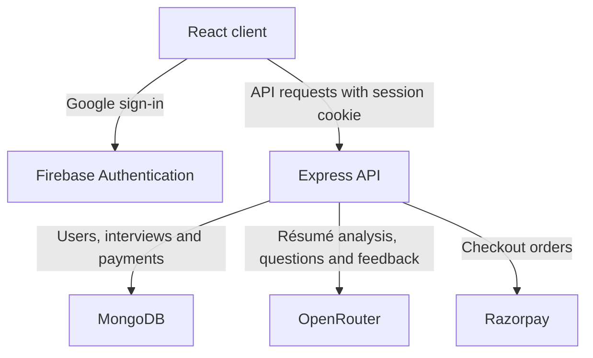

# PAL · Placement Assistant and Learning

PAL helps students practice for placement interviews. The app, branded **InterviewIQ**, turns a target role and experience level into a timed HR or technical interview. After the session, candidates can revisit each answer, read feedback and export a PDF report.

**[Open the live demo](https://pal-placement-assistant-and-learnin.vercel.app/)** · [Local setup](#local-setup) · [API reference](#api-reference)


## Try a practice interview

1. **Sign in with Google.** A new account starts with 100 practice credits.
2. **Choose a role, experience level and interview mode.** For example, select Technical for a Java backend role, or HR to practice how you describe your experience. Optionally upload a text-based PDF résumé (up to 5 MiB) to supply project and skill context.
3. **Start the session.** Generating a session costs 50 credits. The API asks for five questions that progress from easy to hard.
4. **Answer each timed question.** Type in the answer box, or use the microphone in a browser that supports the app’s speech recognition. The client can also read questions aloud. The server uses the submitted answer text to assess confidence, communication and correctness.
5. **Review your results.** Finish the session to see the score breakdown and question-level feedback. Open a past session from History or download its report as a PDF. The Pricing page offers credit top-ups through Razorpay.

| HR interview | Technical interview |
| --- | --- |
|  |  |

## How the app works



### Frontend

The client uses React, Vite, React Router and Redux Toolkit. Axios sends requests with the session cookie. Tailwind CSS and Motion style the interface, Recharts displays the results, and jsPDF builds the downloadable report.

| Path | What you can do |
| --- | --- |
| `/` | Open the home page and start a practice session. |
| `/auth` | Sign in with the Google popup. |
| `/interview` | Set up an interview and answer the generated questions. |
| `/history` | Browse previous interviews. |
| `/report/:id` | Review a saved interview and export its PDF report. |
| `/pricing` | View credit plans and open checkout. |

### Backend

Express handles HTTP requests, Mongoose stores records in MongoDB, and a JWT in an HTTP-only cookie carries the app session. Multer holds an uploaded résumé in memory while the PDF parser extracts text. OpenRouter uses the candidate’s role, experience and optional résumé context to generate questions, then evaluates the submitted answers. Finishing a session aggregates the question scores into a report.

| Stored record | What it contains |
| --- | --- |
| User | Name, email and available practice credits. |
| Interview | Candidate’s role, experience, mode, questions, answers, scores and completion status. |
| Payment | Purchase order and credit details used when processing checkout. |

## Where to find the code

| Path | Start here to understand |
| --- | --- |
| [client/src/App.jsx](client/src/App.jsx) | Page routes, API base URL and initial session lookup. |
| [client/src/pages](client/src/pages) | Home, sign-in, interview, pricing, history and report screens. |
| [client/src/components](client/src/components) | Interview setup, timer, voice input and report export. |
| [client/src/utils/firebase.js](client/src/utils/firebase.js) | Firebase web app and Google provider configuration. |
| [server/index.js](server/index.js) | API startup, database connection, allowed origins and router registration. |
| [server/routes](server/routes) and [controllers](server/controllers) | Endpoints and the logic behind each request. |
| [server/models](server/models) | MongoDB schemas for users, interviews and payments. |
| [server/middlewares](server/middlewares) and [services](server/services) | Session checks, file uploads, OpenRouter and Razorpay integration. |

## Local setup

Use a recent Node.js 22 LTS release with npm, a running MongoDB instance or Atlas cluster, a Firebase web app and an OpenRouter key with access to your selected model.

**1. Install dependencies from the repository root.**

```sh
git clone https://github.com/niteshkumar-11n/PAL-Placement-Assistant-and-Learning-V0.1.git
cd PAL-Placement-Assistant-and-Learning-V0.1
npm install
npm run install-all
```

**2. Create `server/.env`.** Use a long random value for the session secret. Replace the MongoDB URL if you use Atlas.

```dotenv
PORT=5000
MONGODB_URL=mongodb://127.0.0.1:27017/interviewiq
JWT_SECRET=replace-with-a-long-random-secret
OPENROUTER_API_KEY=your-openrouter-api-key
```

| Additional server setting | When to use it |
| --- | --- |
| `OPENROUTER_MODEL` | Select a different model. The source defaults to `openai/gpt-4o-mini`. |
| `RAZORPAY_KEY_ID`, `RAZORPAY_KEY_SECRET` | Supply a matched pair of test keys to exercise Razorpay checkout locally. |
| `CLIENT_URL` | Set the exact HTTPS frontend origin for a separate deployment. Leave unset for local HTTP because setting it also enables secure cross-site cookies. |

**3. Create `client/.env.local`.**

```dotenv
VITE_SERVER_URL=http://localhost:5000
VITE_FIREBASE_APIKEY=your-firebase-web-api-key
```

Use the web key for the Firebase project configured in [the client initializer](client/src/utils/firebase.js). If you use your own Firebase project, update the other web app settings in that file to match. Enable the Google sign-in provider and authorize `localhost` in Firebase Authentication. Keep private service keys in the server environment.

**4. Start both apps.**

```sh
npm run dev
```

Open [the local client](http://localhost:5173). Visit [the API status endpoint](http://localhost:5000/api) to check for `"status": "online"`, then check the server console for `DataBase Connected`. The code defaults to port 6000 when `PORT` is omitted. The example explicitly uses 5000 on both sides.

### Development commands

| Directory | Command | Purpose |
| --- | --- | --- |
| Repository root | `npm run dev` | Start both the Vite client and Express API. |
| Repository root | `npm run client` or `npm run server` | Start either process separately. |
| `client/` | `npm run lint` | Check the frontend source with ESLint. |
| `client/` | `npm run build` | Create the production client bundle in `dist/`. |
| `client/` | `npm run preview` | Preview a completed client build locally. |

## API reference

The interview and payment routes use the session cookie. Browser clients send requests with credentials enabled.

| Method | Path | Purpose |
| --- | --- | --- |
| GET | `/api` | Check whether Express responds. |
| POST | `/api/auth/google` | Establish the app session after the client sign-in flow. |
| GET | `/api/auth/logout` | Clear the session cookie. |
| GET | `/api/user/current-user` | Load the signed-in user. |
| POST | `/api/interview/resume` | Analyze a PDF sent as multipart field `resume` (5 MiB limit). |
| POST | `/api/interview/generate-questions` | Start a session using `role`, `experience` and `mode`, with optional résumé context. |
| POST | `/api/interview/submit-answer` | Submit `interviewId`, `questionIndex`, `answer` and `timeTaken`. |
| POST | `/api/interview/finish` | Finish the interview identified by `interviewId` and summarize its scores. |
| GET | `/api/interview/get-interview` | List the current user's interview history. |
| GET | `/api/interview/report/:id` | Retrieve a saved interview report. |
| POST | `/api/payment/order` | Create a credit purchase order. |
| POST | `/api/payment/verify` | Process the checkout result and update credits. |

## Troubleshooting

| Symptom | What to check |
| --- | --- |
| API requests go to port 5173 | Set `VITE_SERVER_URL` to the Express origin and restart Vite. An empty value uses the frontend origin. |
| Google sign-in fails | Check that the API key and Firebase project settings match, the Google provider is enabled and the browser hostname is authorized. |
| A résumé uploads but yields no text | Export a PDF with selectable text and keep it within the 5 MiB upload limit. |
| The microphone does not transcribe | Use the text box, or allow microphone access in a browser with `webkitSpeechRecognition` support. |
| Question generation fails | Check the account’s practice credits and the server’s OpenRouter key, model access and provider balance. |
